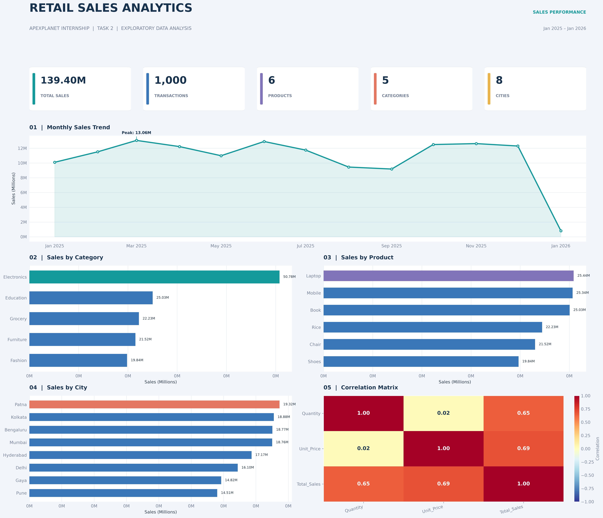

# ApexPlanet Task 2 — Exploratory Data Analysis & SQL Business Analysis

Python-based exploratory data analysis (EDA), SQL business analysis, and retail sales dashboard development completed as part of the ApexPlanet Data Analytics Internship.

## 📊 Project Dashboard



The dashboard summarizes sales performance through monthly trends, category and product comparisons, city-level sales, and correlation analysis.

## 🎯 Project Objectives

- Explore and understand the retail sales dataset.
- Validate data quality and investigate missing values.
- Identify sales trends and top-performing categories, products, and cities.
- Perform business analysis using SQL queries.
- Visualize key findings using Python and Matplotlib.
- Consolidate the analysis into a dashboard.

## 🛠️ Tools and Technologies

- Python
- Pandas and NumPy
- Matplotlib
- Jupyter Notebook
- MySQL
- Git and GitHub

## 📁 Project Structure

```text
02_Task_2_EDA_SQL/
├── dashboard/
│   └── retail_sales_dashboard.png
├── data/
│   └── ApexPlanet_Cleaned_Sales_Dataset.xlsx
├── notebooks/
│   └── EDA.ipynb
├── reports/
│   └── TASK_2_FINDINGS_AND_CHALLENGES.md
├── sql/
│   └── business_analysis.sql
├── visualizations/
│   ├── monthly_sales_trend.png
│   ├── sales_by_category.png
│   ├── sales_by_product.png
│   ├── sales_by_city.png
│   └── correlation_matrix.png
└── README.md
```

## 🔍 Analysis Performed

### 1. Exploratory Data Analysis

- Inspected the dataset structure and data types.
- Examined missing values and duplicate records.
- Analyzed sales by month, product, category, and city.
- Investigated relationships between numerical variables.
- Identified potential high-value outliers for further review.

### 2. SQL Business Analysis

SQL queries were used to perform aggregations, rankings, filtering, grouping, and customer-level investigations.

The analysis included:

- Sales by category and product.
- Monthly sales performance.
- City-level sales comparisons.
- Customer-level analysis.
- Gender and age-group analysis.
- Correlation calculations.
- Data-quality validation.

### 3. Dashboard and Visualizations

Five charts were created to communicate the findings:

| Visualization | Purpose |
|---|---|
| Monthly Sales Trend | Compare sales across months |
| Sales by Category | Identify leading sales categories |
| Sales by Product | Compare product-level sales |
| Sales by City | Compare geographic sales performance |
| Correlation Matrix | Examine relationships between numerical variables |

## 📈 Key Findings

- **Total sales:** 139,399,439.65 in the dataset's numerical units.
- **Top category:** Electronics, with sales of 50,778,581.70.
- **Top product by sales:** Laptop, with sales of 25,443,008.51.
- **Peak sales month:** March 2025, with sales of 13,059,899.94.
- **Highest-sales city:** Patna, with sales of 19,323,101.85.
- **Quantity vs. Total Sales:** Pearson correlation of approximately 0.6466.
- **Unit Price vs. Total Sales:** Pearson correlation of approximately 0.6863.

These findings describe the analyzed dataset and should not be interpreted as proof of causation or future performance.

## 🧹 Data Quality and Validation

The analysis identified:

- 19 missing age values.
- 11 missing city values.
- Zero duplicate rows in the cleaned dataset during the earlier validation.
- Zero discrepancies in the `Quantity × Unit_Price = Total_Sales` check.
- 52 customer IDs associated with multiple customer names.
- 19 potential high-value outliers flagged by the IQR method.

Potential outliers were identified for investigation rather than automatically removed. Customer identity inconsistencies were documented as a limitation.

## ⚠️ Limitations

- January 2026 contains only five transactions and may represent a partial month.
- Missing age and city values limit some demographic and geographic analysis.
- Customer ID and name inconsistencies may affect customer-level results.
- Correlation does not establish causation.
- The dataset's currency and business context should be confirmed before interpreting sales values as a particular currency.

## 🧪 Testing

- Executed the Jupyter notebook after restarting the kernel.
- Verified all five exported chart PNGs.
- Checked the generated dashboard for valid dimensions and non-blank content.
- Completed SQL validation against the MySQL `sales_reimport` table.

## 📄 Detailed Documentation

See [Task 2 Findings and Challenges](reports/TASK_2_FINDINGS_AND_CHALLENGES.md) for the methodology, findings, data-quality issues, problems encountered, solutions, limitations, and future improvements.

## ▶️ How to Run

1. Clone or download the repository.
2. Install the required Python libraries:

   ```bash
   pip install pandas numpy matplotlib openpyxl pillow
   ```

3. Open `notebooks/EDA.ipynb` in VS Code or Jupyter Notebook.
4. Ensure the cleaned dataset is available in the expected `data/` directory.
5. Run the notebook cells to reproduce the analysis and visualizations.

SQL analysis can be reviewed in `sql/business_analysis.sql` and executed in a configured MySQL environment after the dataset has been imported into the expected table.

## 🏁 Conclusion

This project demonstrates an end-to-end data analysis workflow using Python, SQL, and data visualization. It combines data exploration, business analysis, validation, and dashboard presentation to extract meaningful insights from retail sales data.

---

**Project:** ApexPlanet Data Analytics Internship — Task 2  
**Focus:** Exploratory Data Analysis, SQL Business Analysis, and Dashboard Development